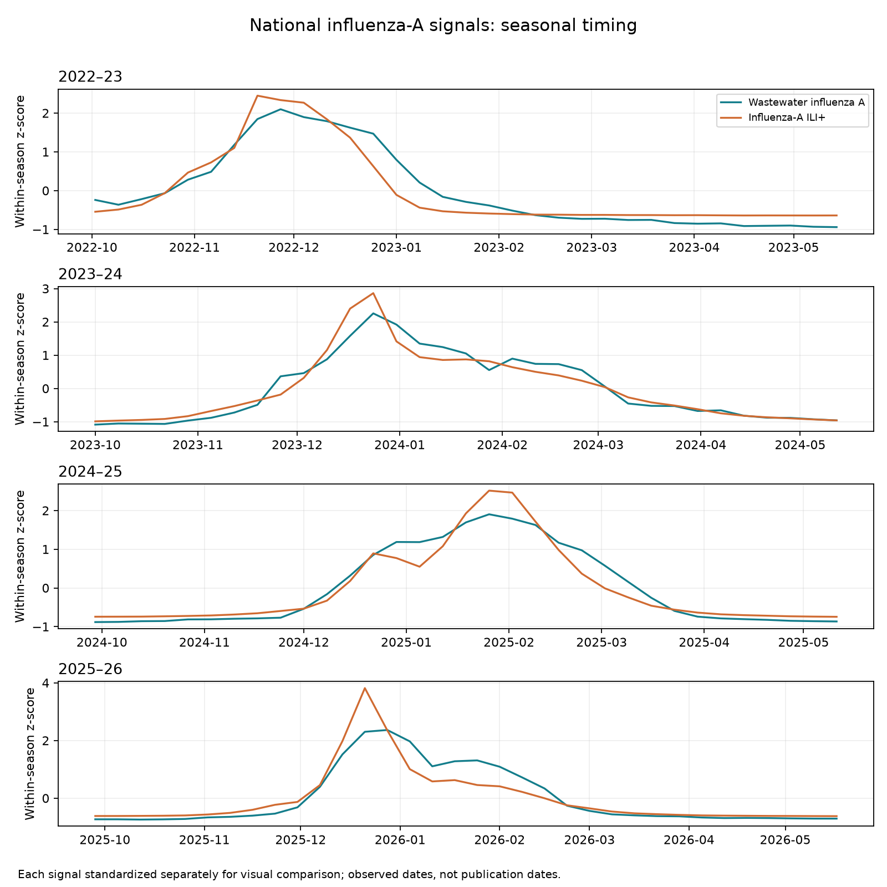
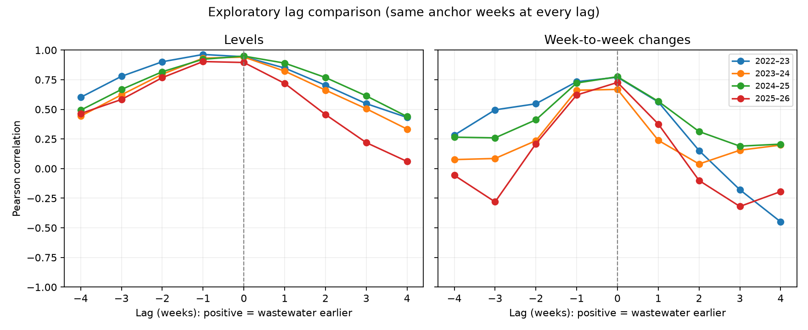

# Wastewater lead-time exploration

## Finding

In this national, weekly comparison, influenza-A wastewater and influenza-A ILI+ move together, but there is no consistent wastewater lead within the examined ±4-week range. This is a descriptive result, not evidence that wastewater can never provide earlier information locally or at finer time resolution.

| Season | Same-week level correlation | Largest level correlation | Lag at maximum | Lag at maximum weekly-change correlation |
| --- | ---: | ---: | ---: | ---: |
| 2022–23 | 0.944 | 0.963 | −1 week | 0 weeks |
| 2023–24 | 0.941 | 0.941 | 0 weeks | 0 weeks |
| 2024–25 | 0.949 | 0.949 | 0 weeks | 0 weeks |
| 2025–26 | 0.896 | 0.904 | −1 week | 0 weeks |

Positive lag means wastewater is earlier: compare wastewater at week t with ILI+ at t + lag. Negative one means the wastewater series is one week later in the maximum-correlation alignment, not earlier. Differences between neighboring correlations are small and were not tested for statistical significance.

Weekly-change correlations at zero lag are 0.771, 0.668, 0.776, and 0.727, respectively. Looking at changes helps check whether the level association only reflects a shared winter rise and fall; it does not remove every form of seasonality or autocorrelation.

## Method

- Use coverage-filtered national `median_site_z` and national `ili_plus_a` from the stretch preparation. Wastewater is the weekly median of site-standardized log concentrations, not an official CDC viral activity level.
- Restrict each season to MMWR weeks 40–20. Include only complete paired seasons: 2022–23 through 2025–26. Exclude 2021–22 (32/33 paired weeks after screening) and ongoing 2026–27 (1/33).
- Preserve the Sunday calendar; missing weeks are not compressed, interpolated, or carried forward.
- Compare Pearson correlations at lags −4 through +4 weeks. This is an exploratory range matching the project's short horizon, not an optimized window.
- At every lag within each season, use the same valid wastewater anchor weeks and require ILI+ values to remain inside that season. Level comparisons use 25 anchor weeks per season (26 in 2025–26 because of the extra MMWR week); first differences use 24 (25 in 2025–26).
- Repeat for week-to-week differences as a descriptive robustness check. Differences are calculated before restricting to common anchor dates.
- The overlay standardizes each signal separately within each season for visual timing comparison; its vertical scales do not compare absolute disease burden.

## Figures





## Interpretation and limits

The data support describing wastewater as a contemporaneous corroborating signal in this comparison, rather than claiming a reliable one-to-four-week early warning. The modest −1-week maxima in two seasons should not be reported as definitive one-week delays.

This analysis uses retrospective observed-week data, including 2025–26, and the existing full-history site standardization. It does not recreate what was available on each publication date, account for all revisions/reporting delays, or test incremental forecast accuracy. It must not be used to tune the held-out forecasting model. No thresholds or model settings were changed.

Four seasons are a small sample; weekly points are autocorrelated, site composition changes, and a count-based coverage screen cannot guarantee representativeness. National aggregation can hide local leads. A future predictive study would need as-of data, training-only transformations, and separate evaluation of whether wastewater improves forecasts beyond ILI+ history.

## Reproduce

```sh
python -m src.explore_wastewater_lead
python -m unittest discover -s tests -p 'test_wastewater*.py'
```

Full results: `results/wastewater_lag_correlations.csv`. A synthetic two-week-leading signal test verifies the lag sign and equal sample sizes across lags, including missing-data cases.
